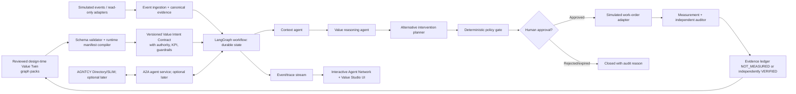

# Target implementation architecture

## Boundaries
1. **Value control plane:** design graph, evidence, intent, policies, owner, baseline, KPI, value economics.
2. **Agent execution plane:** tasks, events, process/actor identities, policies, approvals, tools, timeouts and retries.
3. **Data plane:** synthetic events first, later read-only authorised Spaces/booking/BMS/Splunk/financial adapters.
4. **Presentation plane:** generated screens + isometric visual + node/edge animations + presenter notes.

## Execution maturity gates
- **Gate 0** legacy unit tests and manifest round-trip.
- **Gate 1** local end-to-end UI, simulated events, approval, SQLite log, value evidence.
- **Gate 2** LangGraph with persisted checkpoint, replay/resume, real LLM *optional* behind provider interface.
- **Gate 3** one independently hosted A2A sub-agent exchanging messages and correlated traces. No need for SLIM yet.
- **Gate 4** AGNTCY OASF/Directory registration and optional SLIM secure transport, demonstrated with official compatible releases.
- **Gate 5** customer approved read-only connector pilot; no autonomous physical writes.

## Required observability
At each hop record `{runId, traceId, eventId, correlationId, packId, intentVersion, graphRefs, sourceRefs, status, actor, type, timestamp, evidenceStatus, approvalRef}`. Split business evidence and execution telemetry. OpenTelemetry preferred for distributed tracing once there are multiple processes.
