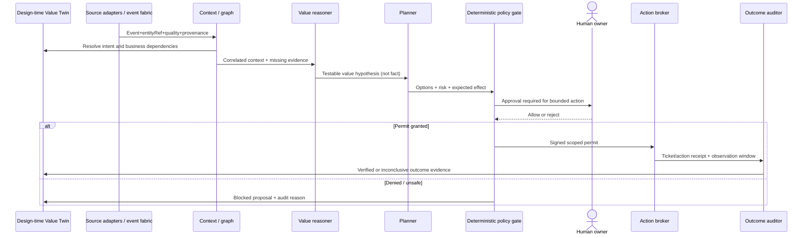

# Runtime architecture and agent choreography

## 1. Six logical capabilities

| Capability | Responsibility | Suggested implementation pattern |
|---|---|---|
| Integration & events | Securely read approved sources; normalise time, schema, entity IDs, units, sensitivity, consent, source fidelity | API adapters, stream or broker, dedupe, contract validation |
| Context & graph | Resolve organisation, site, zone, asset, stakeholder, policy, KPI and use-case relations; source conflict resolution | Graph/semantic store + time-series data; stable IDs; scoped retrieval |
| Agent coordination | Route bounded tasks, persist state, handle retries, escalations and human approval | Durable orchestration/state machine; optional LLM assistants |
| Governance and action broker | Policy checks before and at dispatch; scoped credentials; human permits; commands and receipts | Authorisation service, IAM, policy-as-code, ticket/OT gateways |
| Independent outcome measurement | Normalise baselines, distinguish correlation and causality, check side effects, control for confounders | Measurement service, experimental design, audit ledger |
| Value Twin UI | Tell the board-to-operating-outcome story and expose evidence, active agents and risk gates | Graph-driven studio, real-time subscriptions, presenter mode |

## 2. Specialised roles (logical; not necessarily distinct LLMs)

1. **Signal Steward:** normalise, deduplicate, time-stamp and rate source data quality; avoid an LLM for deterministic ingest.
2. **Context/Graph Resolver:** align zone/site/portfolio references and infer which objectives and stakeholders matter, with explicit data lineage.
3. **Value Reasoner:** assess hypotheses and economic materiality, identify what is *not* known. Never declare savings on correlation alone.
4. **Intervention Planner:** compare options and constraints; surface alternatives, failure modes and benefits-owner requirements.
5. **Policy/Risk Gate:** enforce authority, IEQ/OT/food-safety constraints and hard stops independently of a generative model.
6. **Action Broker:** execute only explicitly permitted workflows, issue receipts, implement idempotency, retry/compensation and rollback when supported.
7. **Outcome Auditor:** independently evaluate pre/post results and unintended impacts; annotate evidence and publish back to the graph, subject to sign-off.

## 3. End-to-end sequence

## 4. Interoperability choices

- **A2A** can provide agent-to-agent tasks where independently operated agents must communicate. It is not orchestration or governance.
- **MCP** can standardise agent-to-tool interfaces, ideally behind permissioned domain adapters. It does not grant action authority.
- **AGNTCY / SLIM** can be evaluated where distributed agents span edge/partner organisations, subject to security architecture, maturity and operations review.
- **OpenTelemetry** spans/traces can correlate agent workflows with app and infrastructure health; logging must minimise personal information.
- **BACnet / authorised BMS gateways** are an interface to building controls, not permission for an LLM to issue direct setpoints.

## 5. Technology allocation

- Agent frameworks (e.g. LangGraph) can coordinate reasoning steps but durable, replayable human-in-the-loop execution and process compensation must be designed deliberately.
- Event sources differ. Cisco Spaces Firehose provides specific occupancy/location streams when entitlement, activation and data governance permit; room bookings, BMS, CMMS, MES and finance data require other adapters.
- For high-risk physical environments, put local deterministic OT controllers and safety interlocks *below* an agentic supervisory layer; maintain manual operations and safe isolation on any runtime failure.

## 6. Design safeguards

A resource cannot be controlled simply because an agent can read its telemetry. Declare independent read, recommend, ticket, adjust-with-approval and automatic control rights. Default to deny. Record every approval and action receipt; short-lived credentials, least privilege, two-person sign-off when necessary, site permissions and emergency override remain external to the model.
