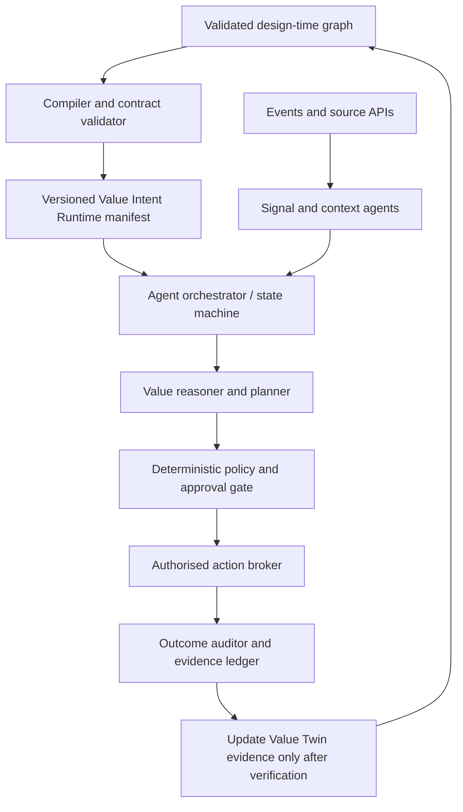

# Architecture: Design-time Value Twin to Operational Multiagent Collaboration

## The control-plane / data-plane separation



The manifest is a **project-specific contract**, not an AGNTCY or Kubernetes standard. It is compiled from linked, human-reviewed Value Twin evidence. It includes the graph entity references, version/hash, owner, KPIs, hypotheses, sources, allowed/denied actions, event handling, approvals, roles and intended audit/measurement outcomes.

### Agent hand-off payload (example)

```json
{
  "eventType": "value.hypothesis.proposed",
  "runId": "run-uuid",
  "intentVersion": "0.1.0",
  "graphRefs": ["b3", "f4", "s2", "h2", "k2"],
  "stage": "value",
  "dataState": "SYNTHETIC",
  "confidence": "UNVALIDATED",
  "proposedIntervention": "Review HVAC schedule, subject to IEQ checks",
  "actionRequest": null,
  "traceId": "trace-id"
}
```

The runtime should expose both the **business graph** (objectives, stakeholders, metrics, value streams) and **execution graph** (events, agents, authorisations, actions, audit). Join them through stable node IDs and run/trace IDs.

### Runtime states and minimum rules

`NEW → OBSERVE → RESOLVE → REASON → PLAN → GUARD → AWAIT_APPROVAL → DRAFT_WORK_ORDER → VERIFY_PENDING`

Rejection is terminal. Every write-capable adapter requires a narrow resource and scope, a separate policy check and approval. `VERIFY_PENDING` cannot be reported as realised savings. At-least-once delivery requires idempotency on all tool actions. Failure and retries must not replay physical actions, and recovery must be tested. Only the full production workflow engine should claim durable crash-safe execution.

### Agent modes

- Deterministic services: ingestion validation, context joins, policy and permission gates, audit/measurement.
- AI reasoning agents: opportunity hypotheses, competing plans, summarisation, orchestration recommendations (bounded, source-cited).
- Human-owned decisions: value owner approval, operations owner approval, benefit sign-off.

**No autonomous control-system action in this starter.**
